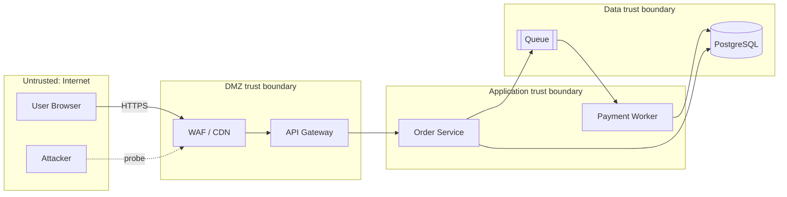

# Threat Modeling

## 1. Purpose

Decide, before building, what can go wrong and what to do about it. Threat modeling is structured adversarial thinking over a data-flow diagram: what are we building, what can go wrong, what are we going to do, and did we do a good job. This skill produces a diagram, a STRIDE-per-element threat list, risk ranking (DREAD or likelihood×impact), and mapped mitigations with owners.

**Scope:** modeling is analysis of your own design. It grants no permission to test systems; any validation against running infrastructure requires separate written authorization.

## 2. Activation Conditions

- New feature, service, or integration design review.
- Adding a new trust boundary (partner API, third-party webhook, public bucket).
- Before a security review or pentest, to focus effort.
- After an incident, to find systemic gaps.
- Regulatory work (PCI DSS, HIPAA, ISO 27001 risk assessments).
- Keywords: threat model, STRIDE, attack surface, trust boundary, DFD, security design review, DREAD.

## 3. When Not to Use

- Single-user local scripts with no network or sensitive data.
- As a one-off deliverable that is never revisited—models must track architecture.
- When the system is already being actively exploited: switch to incident-response.
- Replacing code-level review: mitigation implementation still needs secure-code-review.

## 4. Required Context

1. Architecture diagram or ability to derive one (components, data stores, external entities).
2. Data flows with protocols and direction; where data crosses trust boundaries.
3. Actors: authenticated users, admins, services, third parties, attackers with various capabilities.
4. Assets: what an attacker wants (data, money, compute, reputation, availability).
5. Existing controls: authn/authz, encryption, network segmentation, logging.
6. Business impact ratings for confidentiality, integrity, availability.

## 5. Operating Procedure

1. **Decompose**: draw the DFD (external entities, processes, data stores, flows, trust boundaries).
2. **Enumerate assets and actors**; note where each actor's privilege changes.
3. **Apply STRIDE per element**:
   - Spoofing (authentication), Tampering (integrity), Repudiation (audit), Information disclosure (confidentiality), Denial of service (availability), Elevation of privilege (authorization).
4. **Ask structured questions per flow**: can this flow be replayed, intercepted, faked, or reordered? What if the source is malicious?
5. **Record threats** with attacker capability required (script kiddie, insider, supply chain).
6. **Rank** using likelihood × impact (1–5 each); document the reasoning in one line.
7. **Select mitigations** from: eliminate (remove flow), prevent (control), detect (monitoring), respond (playbook), transfer (insurance/contract), accept (documented).
8. **Assign owner and verification method** for each mitigation ("integration test for replay rejection").
9. **Identify residual risk** after mitigation and get explicit sign-off from the risk owner.
10. **Store the model in the repo**, versioned; add a review trigger whenever the architecture changes.
11. **Validate** a sample of mitigations by test or review—models are hypotheses until checked.

## 6. Tools and Technologies

| Tool | Use |
|---|---|
| OWASP Threat Dragon | DFD + threat rules, open source |
| Microsoft Threat Modeling Tool | STRIDE templates (Windows) |
| `pytm` | Threat model as code |
| IriusRisk / Threatspec | Enterprise/integration |
| Mermaid / draw.io | DFDs in version control |
| MITRE ATT&CK | Attacker technique mapping |
| CVSS / DREAD | Scoring language |

## 7. Practical Implementation

**DFD in Mermaid with trust boundaries:**



**Threat model as code (pytm):**

```python
from pytm import TM, Actor, Boundary, Server, Datastore, Dataflow, Classification

tm = TM("Checkout")
internet = Boundary("Internet")
app = Boundary("App")

user = Actor("Customer"); user.inBoundary = internet
attacker = Actor("Attacker"); attacker.inBoundary = internet

api = Server("Checkout API"); api.inBoundary = app
api.protocol = "HTTPS"; api.authenticates = True
db = Datastore("Orders DB"); db.inBoundary = app
db.isEncrypted = True

Dataflow(user, api, "submit order")
Dataflow(api, db, "write order")
Dataflow(attacker, api, "malicious request")

tm.process()
```

**Threat register (Markdown table kept in repo):**

```markdown
| ID | Element | STRIDE | Threat | Likelihood | Impact | Score | Mitigation | Owner | Status |
|----|---------|--------|--------|-----------|--------|-------|------------|-------|--------|
| T-01 | API→DB flow | Tampering | Attacker alters order total via mass-assignment | 4 | 5 | 20 | Explicit field allowlist in request schema; server recomputes totals | @pay | Open |
| T-02 | Checkout API | Spoofing | Stolen session cookie replay | 3 | 4 | 12 | Short-lived tokens, rotation, device binding, anomaly alerts | @auth | Open |
| T-03 | Queue | Repudiation | Duplicate payment event | 3 | 5 | 15 | Idempotency keys + processed_events table | @pay | Verified |
| T-04 | Webhook in | Elevation | Forged provider webhook marks order paid | 2 | 5 | 10 | HMAC signature verification with timestamp window | @pay | Open |
```

**Mass-assignment guard (FastAPI):**

```python
from pydantic import BaseModel, Field

class OrderUpdate(BaseModel):
    model_config = {"extra": "forbid"}      # reject unknown fields
    quantity: int = Field(ge=1, le=99)
    # NOTE: total_cents intentionally absent — recomputed server-side
```

**Replay-resistant webhook (Python):**

```python
import hmac, hashlib, time

def verify_webhook(body: bytes, sig: str, ts: str, secret: bytes, tolerance_s: int = 300) -> None:
    if abs(time.time() - int(ts)) > tolerance_s:
        raise ValueError("stale webhook")
    expected = hmac.new(secret, f"{ts}.".encode() + body, hashlib.sha256).hexdigest()
    if not hmac.compare_digest(expected, sig):
        raise ValueError("bad signature")
```

## 8. Quality Standards

- DFD includes every trust boundary crossing; no flow "teleports" across a boundary.
- Each threat names the element, the STRIDE letter, and the attacker capability.
- Every high/critical threat has a mitigation, an owner, and a verification method.
- Accepted risks have a named risk owner and a review date.
- The model is stored with the code and referenced from the design doc.
- Threats are specific to this system, not copied from a generic list.

## 9. Verification and Testing

- Convert mitigations into tests: replay test, forged-signature test, cross-tenant test, rate-limit test.
- Review the model with someone who did not write it (adversarial review).
- Map threats to MITRE ATT&CK techniques to catch families missed.
- Re-run the model after major design changes; diff the register.
- Evidence: register with statuses, test names linked per mitigation, sign-off record.

## 10. Security Considerations

- The threat model is sensitive: it is a map of weaknesses. Restrict access; never attach it to public tickets.
- Do not include real exploit chains against production in the doc; describe capability and effect.
- Validation testing requires authorization and must be non-destructive.
- When third parties are in scope, include them in the model (their compromise is your threat).
- Supply chain must be an element: dependencies, CI, artifact registry, and update channels are trusted and therefore attackable.

## 11. Failure Handling

- **Model becomes too large:** scope to one system/feature, or rank threats and drop the tail with an explicit note.
- **Team argues likelihood:** use ranges and state assumptions; revisit after incident data exists.
- **Mitigation too expensive:** propose detection/response instead of prevention, and record the accepted residual risk.
- **Architecture changes constantly:** attach the model to the design doc and require an update in the ADR for structural decisions.
- **No one owns it:** assign to the service owner as part of the definition of done.

## 12. Expected Deliverables

1. Data-flow diagram with trust boundaries.
2. Asset and actor inventory.
3. STRIDE threat register with scores.
4. Mitigation plan with owners and verification methods.
5. Residual-risk statement with sign-off.
6. Storage location and review cadence.

## 13. References

- OWASP Threat Modeling — https://owasp.org/www-community/Threat_Modeling
- OWASP Threat Dragon — https://owasp.org/www-project-threat-dragon/
- Shostack, *Threat Modeling: Designing for Security*.
- Microsoft SDL threat modeling — https://learn.microsoft.com/en-us/security/engineering/threat-modeling-aiml
- pytm — https://github.com/OWASP/pytm
- MITRE ATT&CK — https://attack.mitre.org/
- NIST SP 800-154 (data-centric threat modeling) — https://csrc.nist.gov/pubs/sp/800/154/ipd
