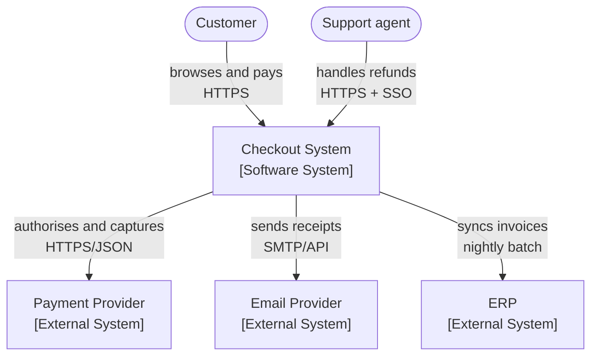
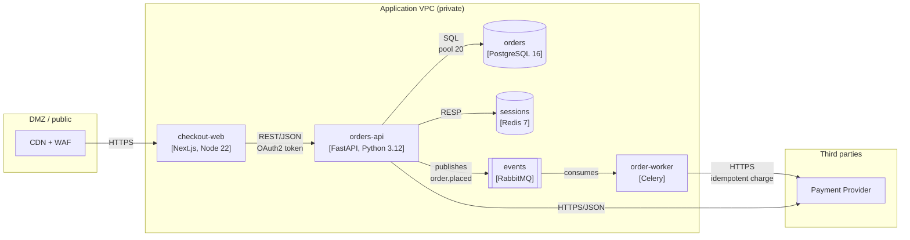
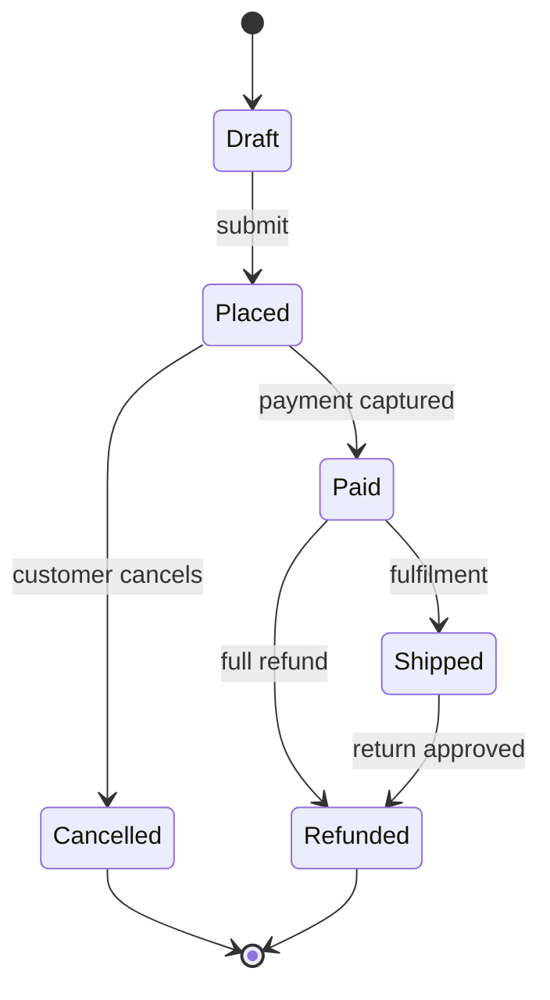
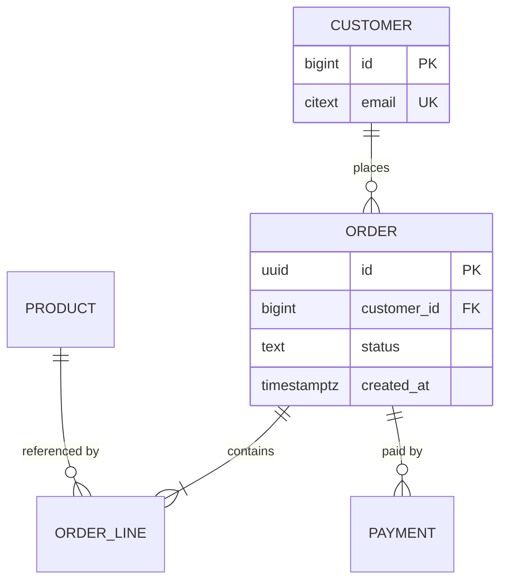

# Technical Diagramming

## 1. Purpose

Use diagrams to make structure and flow legible in seconds. Most architecture diagrams fail because they mix abstraction levels (browsers next to database indexes), use undefined symbols (arrows that mean "calls" in one place and "replicates" in another), and are images that cannot be reviewed or updated. This skill covers choosing the right diagram for the question, abstraction levels, text-based diagram tooling, and the legends and conventions that keep meaning stable.

**Scope:** your own documentation. System diagrams can disclose internal topology to attackers—set visibility deliberately and keep production hostnames, IP ranges, and credentials out of published diagrams.

## 2. Activation Conditions

- Explaining a system, a flow, or a proposed change to others.
- Design docs, RFCs, incident postmortems, or onboarding material need visuals.
- Existing diagrams are stale, unreadable, or inconsistent.
- Cross-team misunderstanding of a boundary or dependency.
- Keywords: architecture diagram, C4 model, sequence diagram, Mermaid, PlantUML, D2, flowchart, ER diagram, legend, context diagram, dependency graph, state machine.

## 3. When Not to Use

- The reader needs precise field-level detail (use an API reference or schema).
- A table conveys the information more clearly (comparisons, options).
- The diagram would have more than ~15 elements (split by level instead).

## 4. Required Context

1. The question the diagram must answer (structure, flow, state, data, or timeline).
2. Audience: executives, engineers, new joiners, security reviewers.
3. Abstraction level: context, container, component, or code.
4. Tooling available and whether diagrams must be version-controlled.
5. Publication scope: internal, partner, or public.

## 5. Operating Procedure

1. **State the question first** ("where does a payment request travel, and where can it fail?") and pick the diagram type that answers it.
2. **Pick one abstraction level** using C4: context (users + systems), container (deployable units), component (modules inside a container), code (rarely needed). Never mix levels in one diagram.
3. **Choose text-based diagrams** (Mermaid, D2, PlantUML) so they diff, review, and live next to the code; fall back to vector tools only for layout-heavy figures.
4. **Define a legend** and reuse it: what each shape, line style, and color mean. If a symbol has two meanings in one diagram, fix the diagram.
5. **Label every arrow with the protocol/purpose** ("HTTPS/JSON", "gRPC", "publishes order.placed") and direction.
6. **Show boundaries explicitly**: trust boundaries, service ownership, network zones, and tenant isolation — especially for security review.
7. **Keep it small**: 7 ± 2 elements for comprehension; split complex systems into a set of diagrams linked from a page.
8. **Use consistent naming** matching the code and docs (same service names, same case).
9. **Show failure and degraded paths** where relevant (fallback, retry, circuit breaker), not just the happy path.
10. **Version and review** diagrams with the docs; a diagram in a design doc is reviewed as part of the doc.
11. **Validate**: ask a reader to trace one request using only the diagram; if they cannot, it is incomplete.

## 6. Tools and Technologies

| Need | Options |
|---|---|
| Flow/sequence/graphs in Markdown | Mermaid (`flowchart`, `sequenceDiagram`, `stateDiagram-v2`, `erDiagram`) |
| Richer text diagrams | D2, PlantUML, Graphviz DOT |
| Hand-drawn feel | Excalidraw (export SVG), tldraw |
| Cloud-specific icons | draw.io / diagrams.net with provider icon sets |
| Auto-generated | dependency-cruiser/madge graphs, `pydeps`, AWS infrastructure diagrams |
| Preview | VS Code Mermaid preview, GitHub-native rendering, Docusaurus/MkDocs plugins |

## 7. Practical Implementation

**C4 context diagram (who uses the system and what it depends on):**



**Container-level diagram with trust boundaries:**



**Sequence diagram for a critical flow, including failure:**

```mermaid
sequenceDiagram
  autonumber
  participant C as Client
  participant A as orders-api
  participant R as Redis
  participant D as Postgres
  participant P as Payment Provider

  C->>A: POST /v1/orders/{id}/pay (Idempotency-Key)
  A->>R: GET sess:{id}
  alt session miss
    A->>D: SELECT order (fallback path)
    D-->>A: order row
    A->>R: SET sess:{id} EX 1800
  end
  A->>P: POST /charges (Idempotency-Key)
  alt provider declines
    P-->>A: 402 card_declined
    A-->>C: 422 problem+json /card-declined
  else provider approves
    P-->>A: 200 charge_id
    A->>D: BEGIN; UPDATE order; INSERT payment; COMMIT
    A-->>C: 200 order (paid)
  end
  Note over A,P: retries reuse the same provider idempotency key
```

**State machine for an entity with legal transitions:**



**ER diagram for the data model (key relationships and constraints):**



**Legend block reused across a doc set:**

```markdown
**Legend**
- Rectangle: deployable container. Parallelogram: external system. Cylinder: datastore.
- Solid arrow: synchronous call (label = protocol). Dashed arrow: asynchronous message.
- Thick border: trust boundary. Everything inside a `subgraph` shares a network zone.
- Red dashed arrow: failure/degraded path.
```

**D2 example for a dependency view with layout controls:**

```d2
direction: right

web: checkout-web {shape: rectangle}
api: orders-api {shape: rectangle}
db: Postgres {shape: cylinder}
bus: events {shape: queue}

web -> api: REST/JSON
api -> db: SQL
api -> bus: publish order.placed {style.stroke-dash: 3}
```

**Auto-generated dependency graph (never hand-maintained):**

```bash
npx madge src --image docs/diagrams/deps.svg --extensions ts,tsx
npx depcruise --output-type dot src | dot -Tsvg > docs/diagrams/cruise.svg
```

**Diagram checklist before publishing:**

```text
[ ] One question answered; one abstraction level
[ ] Every arrow labelled with protocol/purpose and direction
[ ] Legend present; symbols consistent
[ ] Boundaries (trust, network, ownership) shown where relevant
[ ] Names match the code and other docs
[ ] Failure/degraded paths included where the question needs them
[ ] ≤ ~9 primary elements; larger systems split into linked diagrams
[ ] Source file committed next to the doc (not a binary-only image)
[ ] No hostnames, IPs, credentials, or customer data
```

## 8. Quality Standards

- Each diagram answers one stated question at one abstraction level.
- Diagrams are text source files committed with docs, rendered in the docs build.
- Every arrow is labelled and directional; no unlabelled or ambiguous symbols.
- A legend exists where any symbol could be misread (colors, shapes, line styles).
- Trust boundaries are explicit in any security-relevant diagram.
- Naming matches the codebase and API reference exactly.
- Diagrams are updated in the same change as the system they describe.
- Public diagrams contain no internal topology details or credentials.

## 9. Verification and Testing

- Reader test: someone unfamiliar traces a request through the diagram and finds no missing step.
- Render test: diagrams render in GitHub, the docs site, and dark mode without unreadable contrast.
- Diff test: a change to the system produces a reviewable diff in the diagram source.
- Consistency check: every service in the diagram exists in the deployment manifests (and vice versa).
- Accessibility: provide a text alternative (the Mermaid source counts) and avoid color-only encoding.

## 10. Security Considerations

- Public diagrams aid reconnaissance: omit internal hostnames, IP ranges, ports, admin endpoints, and versions.
- Show trust boundaries and authentication points explicitly in review diagrams so reviewers can see where checks occur.
- Do not diagram secrets flows in a way that reveals credential storage locations publicly.
- Redact production identifiers in incident diagrams shared more broadly.
- If a diagram is generated from live infrastructure, ensure the export does not include tags containing secrets or customer identifiers.

## 11. Failure Handling

- **Diagram is unreadable:** too many elements at one level; split into context + container + sequence.
- **Diagram goes stale:** hand-drawn images are the cause. Move to text sources in the repo and generate dependency graphs automatically.
- **Readers misread an arrow:** add a legend and label the protocol; do not rely on color alone.
- **Mermaid fails to render in the target platform:** verify supported diagram types; fall back to a committed SVG with the source beside it.
- **Layout tools produce spaghetti:** switch view (context vs. sequence) rather than fighting layout.

## 12. Expected Deliverables

1. Diagram set (context, container, sequence/state as needed) with sources.
2. Legend and naming conventions.
3. Rendered images or embedded diagrams in the docs.
4. Auto-generated dependency graph wired into CI.
5. Review notes confirming the reader test.

## 13. References

- C4 model — https://c4model.com/
- Mermaid documentation — https://mermaid.js.org/intro/
- D2 documentation — https://d2lang.com/
- PlantUML — https://plantuml.com/
- diagrams.net — https://www.drawio.com/
- madge — https://github.com/pahen/madge
- AWS architecture icons — https://aws.amazon.com/architecture/icons/
- "Communicating Architecture" (Simon Brown, C4 presentations) — https://c4model.com/#Presentations
