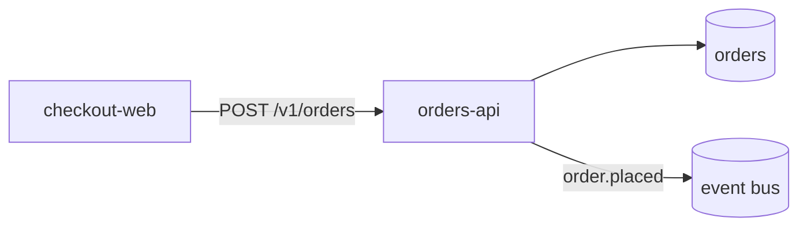

# Technical Writing

## 1. Purpose

Produce documentation that lets a reader accomplish a task without asking a human. Most technical documentation fails for structural reasons: it is organized around the code instead of the reader's goal, it describes what a feature is rather than what to do, it omits prerequisites and error cases, and nobody owns it after publication. This skill covers audience definition, document types, structure, language, examples, and maintenance.

**Scope:** your own documentation. Do not copy text, screenshots, or code from sources whose license does not permit it, and never publish internal endpoints, credentials, or customer details.

## 2. Activation Conditions

- Writing a README, how-to, tutorial, reference page, or runbook.
- Docs exist but users keep asking the same questions.
- Onboarding takes weeks because knowledge is tribal.
- Migrating docs to a new structure or site.
- Keywords: technical writing, documentation, README, tutorial, how-to, reference, explanation, Diátaxis, docs-as-code, style guide, plain language, changelog.

## 3. When Not to Use

- API reference generated mechanically from a schema (use api-design and generator tooling; still curate the prose).
- Marketing copy (different objective and audience).
- Internal chat answers that need no permanence.

## 4. Required Context

1. The reader: role, prior knowledge, and the task they are trying to finish.
2. Where the doc lives and how it is published (repo, docs site, wiki).
3. Existing style guide and terminology.
4. Version scope (which product versions this applies to).
5. Owner and review path.

## 5. Operating Procedure

1. **Name the reader and their task** in one sentence before writing: "A backend engineer who needs to rotate an API key without downtime."
2. **Choose the document type** deliberately (Diátaxis): tutorial (learning), how-to (task), reference (lookup), explanation (understanding). Do not mix them in one page.
3. **Lead with the outcome**, then prerequisites, then steps. A reader must be able to tell in 10 seconds whether the page answers their question.
4. **Write procedures as numbered, verifiable steps**: one action per step, expected result stated, copy-pasteable commands with placeholders clearly marked.
5. **Show a complete working example** end to end, not fragments that require guessing the surrounding code.
6. **Cover failure modes**: what errors look like, what they mean, and the fix. Errors are where readers spend most of their time.
7. **Use plain language**: active voice, second person, short sentences, no idioms; define jargon on first use.
8. **Format for scanning**: descriptive headings, short paragraphs, tables for options, code blocks with language tags, callouts for warnings.
9. **Keep code and prose in sync** by testing snippets where possible and by generating reference from source.
10. **Add front matter**: last-reviewed date, owner, applicable versions, and a "was this helpful" path.
11. **Review with someone who matches the audience**, not only the author's peers.
12. **Schedule review** at each major version change; docs decay faster than code.

## 6. Tools and Technologies

| Concern | Options |
|---|---|
| Docs-as-code | Markdown in repo, MkDocs Material, Docusaurus, Sphinx, Starlight |
| API reference | OpenAPI + Redoc/Scalar, TypeDoc, Sphinx autodoc |
| Diagrams | Mermaid (text-based, diffable), Excalidraw |
| Linting | Vale (prose style), markdownlint, `codespell` |
| Link checking | `lychee`, `markdown-link-check` |
| Snippet testing | `pytest --doctest-glob`, `mdx` test runners, `mdbook test` |
| Style references | Google developer documentation style guide, Microsoft Writing Style Guide |

## 7. Practical Implementation

**README template that answers the first five questions:**

```markdown
# orders-api

Creates and settles customer orders; emits `order.*` events.

- **Status:** production · **Owner:** @payments-platform
- **Docs:** https://docs.example.com/orders-api

## What it does
Accepts order creation, applies pricing and inventory checks, and publishes lifecycle events.

## Quick start
```bash
docker compose up -d db
cp .env.example .env          # set DATABASE_URL, then:
make migrate && make run
curl -s localhost:8080/healthz
```

## Requirements
- Python 3.12+, Postgres 16+, Docker

## How it fits


## Troubleshooting
| Symptom | Cause | Fix |
|---|---|---|
| `503 database unavailable` | pool exhausted | check `DB_POOL_SIZE`, see runbook §3 |
```

**Task-oriented how-to page:**

```markdown
# Rotate an API key without downtime

**Audience:** platform engineers with admin access to the console.
**Time:** ~10 minutes. **Impact:** none if you follow the order below.

## Before you start
- [ ] Admin role in the console
- [ ] Access to your secret manager
- [ ] A staging environment to rehearse (recommended)

## Steps

1. **Create the new key.** Console → Settings → API keys → **Create key**.
   Name it `prod-2026-11`. You will see the value once; store it immediately.

   Expected: the key appears in the list with status *Pending*.

2. **Write the new key to the secret manager** as `ORDERS_API_KEY_NEXT`.
   Do not overwrite the current value.

3. **Deploy the application** with both keys configured. The client prefers
   `ORDERS_API_KEY_NEXT` and falls back to the old key.

   ```bash
   kubectl -n prod set env deploy/orders-api ORDERS_API_KEY_NEXT=... 
   kubectl -n prod rollout status deploy/orders-api --timeout=180s
   ```

4. **Confirm traffic is on the new key.** In the console, the old key's request
   count should fall to zero within 15 minutes.

5. **Revoke the old key** once its request count is zero for 30 minutes.

## If something goes wrong
- **401s after step 3:** the new key was truncated when copied. Re-enter it, then redeploy.
- **Old key still in use after 30 minutes:** a client is caching credentials; check the
  services listed under *Key usage* and restart them.
```

**Reference entry shape (lookup optimized):**

```markdown
### `POST /v1/orders`

Creates an order in `draft` status.

| Parameter | Type | Required | Notes |
|---|---|---|---|
| `customer_id` | integer | yes | must exist and be active |
| `lines` | array | yes | 1–100 items; `quantity` ≥ 1 |
| `idempotency_key` | header | yes | 8–64 chars; reuse only for identical retries |

**Responses:** `201` with `Location`; `422` with problem details; `409` on duplicate key with a different body.

```bash
curl -X POST https://api.example.com/v1/orders \
  -H "Authorization: Bearer $TOKEN" -H "Idempotency-Key: $(uuidgen)" \
  -H "Content-Type: application/json" \
  -d '{"customer_id":42,"lines":[{"product_id":7,"quantity":2}]}'
```
```

**Prose linting with Vale:**

```ini
# .vale.ini
StylesPath = styles
MinAlertLevel = suggestion
[*.md]
BasedOnStyles = Vale, Google

# styles/Google/Headings.yml (excerpt): flag "will", passive voice, Latin abbreviations
```

```bash
vale --output=line docs/
markdownlint-cli2 "docs/**/*.md"
lychee --no-progress "docs/**/*.md"
```

**Glossary discipline (one term per concept):**

```markdown
| Use | Do not use | Why |
|---|---|---|
| sign in | log in, login | one term, and "login" is a noun only |
| API key | token, key | distinguishes from session tokens |
| customer | client, account | matches the domain model |
```

**Changelog entry format (user-facing, not commit log):**

```markdown
### 2026-11-04 — v2.14.1
### Fixed
- Refunds now reject amounts above the remaining balance (`422` instead of `500`). (#3456)
### Deprecated
- `POST /v1/orders/legacy` will be removed 2027-01-31; migrate to `POST /v1/orders`.
```

**Doctest-style verification of examples:**

```python
def total_cents(lines: list[dict]) -> int:
    """Sum line totals.

    >>> total_cents([{"quantity": 2, "unit_cents": 500}])
    1000
    >>> total_cents([])
    0
    """
    return sum(line["quantity"] * line["unit_cents"] for line in lines)
```

```bash
pytest --doctest-modules app/
```

## 8. Quality Standards

- The first screen answers: what is this, who is it for, and what do I do first.
- Every procedure has prerequisites, numbered steps with expected results, and a troubleshooting section.
- Code samples are complete, runnable, and use clearly marked placeholders.
- One term per concept, enforced by a glossary; no synonyms drifting across pages.
- No unmodified jargon without a definition; expanded acronyms at first use.
- Warnings and destructive steps are visually distinct and placed before the step.
- Each page lists an owner and a last-reviewed date.
- Style and links are linted in CI; broken links fail the build.

## 9. Verification and Testing

- **Task test**: give the draft to someone matching the audience and watch them complete the task without help; note every hesitation.
- Copy-paste every command in a clean environment; record any that fail.
- Run doctest/snippet tests for code examples.
- Link check in CI; check both internal anchors and external URLs.
- Read the page on mobile and with a screen reader for structural correctness (headings, alt text, table headers).
- Compare terminology against the glossary with a grep for banned terms.

## 10. Security Considerations

- Never include real credentials, tokens, internal hostnames, or customer data in examples; use obvious placeholders (`$TOKEN`, `example.com`).
- Screenshots frequently contain identifiers, emails, and session tokens—redact before publishing.
- Documenting a security control means documenting its limits too; avoid implying protection that does not exist.
- Do not publish exploit details for unpatched vulnerabilities; coordinate disclosure.
- Be careful with internal architecture diagrams in public docs—they aid reconnaissance.
- Set permissions on internal docs; a public wiki leak of a runbook is an operational risk.

## 11. Failure Handling

- **Docs drift from code:** generate what can be generated (API reference, CLI help), test what can be tested (snippets), and review on release.
- **Readers still ask questions:** the page answers the wrong question. Rewrite the title and first paragraph around the actual question being asked in support.
- **Tutorial and reference mixed:** split into two pages; tutorials omit options, reference omits narrative.
- **Page too long:** split by task; long pages are usually several documents in one.
- **Translation breaks formatting:** avoid idioms, keep sentences short, do not embed text in images.

## 12. Expected Deliverables

1. Document with audience, prerequisites, steps, and troubleshooting.
2. Working end-to-end example.
3. Glossary entries for any new terms.
4. Owner and review date.
5. Lint and link-check configuration.
6. Task-test notes from a reader test.

## 13. References

- Diátaxis documentation framework — https://diataxis.fr/
- Google developer documentation style guide — https://developers.google.com/style
- Microsoft Writing Style Guide — https://learn.microsoft.com/style-guide/welcome/
- Vale prose linter — https://vale.sh/docs/
- markdownlint — https://github.com/DavidAnson/markdownlint
- lychee link checker — https://github.com/lycheeverse/lychee
- Write the Docs community guides — https://www.writethedocs.org/guide/
- "Docs for Developers" (Bhatti et al.).
