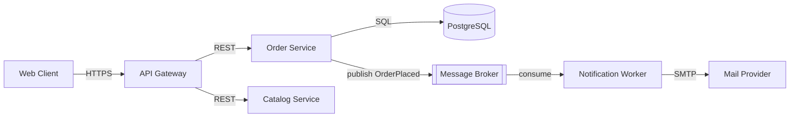

# System Architecture

## 1. Purpose

Produce a defensible architecture for a software system: the components, their responsibilities, the interfaces between them, the data ownership model, and the runtime/deployment topology. The skill solves the problem of agents and engineers jumping to code before deciding where state lives, how modules communicate, and which quality attributes (latency, availability, consistency, cost) the design optimizes for. Output is a decision-ready architecture description with explicit trade-offs, not a diagram alone.

## 2. Activation Conditions

Activate when the task involves:

- Greenfield design: "design", "architect", "propose a system for", "how should we structure".
- Splitting or merging services, defining module boundaries, or monolith-vs-services questions.
- Choosing between synchronous calls, queues, events, and batch pipelines.
- Multi-system integration, data ownership, or consistency questions.
- Review of an existing architecture for scalability, coupling, or failure isolation.
- Keywords: architecture, topology, bounded context, service boundary, data flow, scalability, availability, DDD, CQRS, event-driven.

## 3. When Not to Use

- Single-file scripts, one-off automation, or prototypes under one week with no external consumers.
- Pure implementation tasks where boundaries are already fixed and documented.
- Framework-specific setup (use the framework skill instead).
- Performance micro-tuning of a single function (use performance-optimization).
- When an approved architecture exists and the task is to conform to it—read the ADRs instead.

## 4. Required Context

Before designing, inspect or ask for:

1. **Functional scope** — the top 5–10 user journeys the system must support now.
2. **Scale envelope** — expected requests/sec, data volume, growth over 12 months, peak-to-average ratio.
3. **Quality attribute priorities** — rank: latency, availability, consistency, durability, cost, team delivery speed, compliance.
4. **Constraints** — mandated cloud, on-prem requirement, existing databases, team skills, budget, deadlines.
5. **Data classification** — PII, payment data, health data; retention and residency rules.
6. **Team topology** — number of teams and their ownership, since Conway's law is a real constraint.
7. **Existing systems** — what the new system must integrate with, and their SLAs.
8. **Operational maturity** — can they run Kubernetes? Do they have observability, on-call, and IaC?

If items 1–4 are unknown, ask; do not invent scale numbers.

## 5. Operating Procedure

1. **Restate the problem and scope.** Write 3–6 sentences: users, core jobs, explicit non-goals. Get confirmation if assumptions are material.
2. **Extract quality attribute scenarios** in stimulus-response form: "When a payment provider times out, the API returns a degraded response within 2 s and the order is queued for retry."
3. **Model the domain.** Identify entities, aggregates, and ownership boundaries. Group by change frequency and transactional consistency needs, not by org chart.
4. **Sketch candidate topologies.** Minimum two: a simple one (modular monolith) and a scaled one (services + queue). Never present only the complex option.
5. **Evaluate with a decision table.** Rows: candidates. Columns: delivery speed, operational cost, failure isolation, consistency complexity, scalability ceiling. Score 1–5 with a one-line justification per cell.
6. **Define interfaces.** For each boundary: protocol (HTTP/JSON, gRPC, events), payload shape, idempotency key, timeout, retry policy, and error contract.
7. **Define data ownership.** Exactly one writer per entity. State where the source of truth lives and how copies are synchronized (CDC, outbox, polling).
8. **Design failure modes.** For every synchronous edge: what happens on timeout, partial failure, and duplicate delivery. Prefer async where the user does not need an immediate answer.
9. **Select the deployment topology.** Containers on managed orchestrator vs. PaaS vs. serverless. Justify by operational maturity, cold-start tolerance, and cost curve.
10. **Produce the diagram** (C4 context + container level) using Mermaid or Structurizr DSL so it lives in version control.
11. **Record decisions as ADRs** for each irreversible choice.
12. **Define the validation plan.** What load test, chaos test, or spike proves the design meets the quality scenarios.

## 6. Tools and Technologies

| Tool | Use |
|---|---|
| Structurizr DSL / C4 model | Version-controlled architecture diagrams |
| Mermaid (`flowchart`, `sequenceDiagram`) | Inline diagrams in Markdown |
| PlantUML | Detailed sequence and component diagrams |
| OpenAPI 3.1 / AsyncAPI | Interface contracts |
| ADR templates (MADR, Nygard) | Decision records |
| k6 / Gatling | Load validation of the design |
| Toxiproxy / Chaos Mesh | Failure-mode validation |
| EventStorming | Domain discovery workshops |

## 7. Practical Implementation

**C4 container view in Mermaid:**



**Interface contract sketch:**

```yaml
# AsyncAPI fragment
channels:
  order.placed:
    publish:
      message:
        payload:
          type: object
          required: [order_id, tenant_id, occurred_at]
          properties:
            order_id: {type: string, format: uuid}
            tenant_id: {type: string}
            occurred_at: {type: string, format: date-time}
        headers:
          type: object
          properties:
            idempotency_key: {type: string}
```

**Decision table:**

| Candidate | Delivery | Ops cost | Failure isolation | Consistency | Scale ceiling |
|---|---|---|---|---|---|
| Modular monolith + 1 DB | 5 | 5 | 2 | 5 | 3 |
| 3 services + broker | 3 | 3 | 4 | 3 | 4 |
| Serverless functions | 4 | 4 | 4 | 2 | 5 |

**Quality scenario template:**

> **Scenario:** Provider timeout. **Source:** payment gateway. **Stimulus:** 30 s no response. **Artifact:** checkout flow. **Response:** order marked `pending_payment`, user sees retry option. **Measure:** within 2 s, zero duplicate charges.

## 8. Quality Standards

- Every boundary has a single owner and a stated reason to exist.
- No shared database across independently deployed services.
- Every synchronous dependency has a timeout and a defined degraded behavior.
- Diagrams are text-based and committed alongside code.
- Trade-offs are explicit; no architecture is presented as having no downside.
- The simplest topology that meets the ranked quality attributes wins; complexity must be earned.
- Naming is consistent between diagram, code, and API.

## 9. Verification and Testing

- **Contract tests** (Pact or schema validation) between producers and consumers.
- **Load test** at 2× expected peak with the target p95 latency asserted.
- **Failure injection:** kill a dependency, block a port, add 3 s latency; confirm the documented behavior.
- **Architecture fitness functions:** e.g. a test that fails if a module imports another module's internals (`import-linter` contracts, ArchUnit rules).
- Evidence: load-test report, contract-test output, and the failure-injection log.

## 10. Security Considerations

- Treat all external input and third-party responses as untrusted; validate at the boundary.
- Define trust zones on the diagram (public edge, application, data, admin) and forbid direct public access to data stores.
- Identify where authentication terminates, how tokens propagate, and which services authorize.
- Classify data flows; mark PII and secrets paths and require TLS in transit and encryption at rest.
- Do not place secrets in diagram annotations or committed configs.
- State blast radius per component and require least privilege for each service identity.

## 11. Failure Handling

- **Scale numbers unknown:** design for 10× headroom on the stated figure, and note the assumption.
- **Stakeholders disagree on boundaries:** resolve by data ownership and transaction boundaries, not opinion; document dissent in the ADR.
- **Diagram drift from code:** add a fitness function or generate diagrams from code where feasible.
- **Over-engineering detected:** cut to the simple candidate and note the trigger that would justify escalation (e.g. ">50k msg/s or >3 teams").
- **Premature technology mandate:** record it as a constraint with the cost it imposes.

## 12. Expected Deliverables

1. Scoped problem statement with non-goals.
2. Ranked quality attribute scenarios with measures.
3. C4 context and container diagrams (text-based).
4. Component responsibility and interface table.
5. Data ownership and consistency model.
6. Failure-mode analysis per edge.
7. Decision table with justified trade-offs.
8. ADRs for irreversible decisions.
9. Validation plan (load, chaos, contract tests).

## 13. References

- C4 model — https://c4model.com/
- Structurizr DSL — https://docs.structurizr.com/dsl
- Mermaid documentation — https://mermaid.js.org/
- MADR ADR template — https://adr.github.io/madr/
- AsyncAPI specification — https://www.asyncapi.com/docs
- OpenAPI specification — https://spec.openapis.org/oas/latest.html
- AWS Well-Architected Framework — https://docs.aws.amazon.com/wellarchitected/latest/framework/welcome.html
- "Software Architecture: The Hard Parts" (Ford, Richards, Sadalage, Dehghani), O'Reilly.
